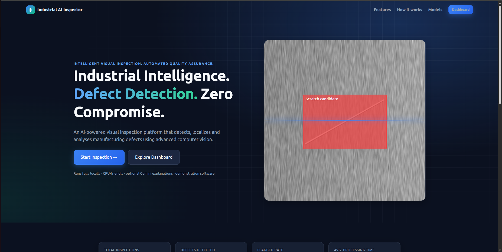
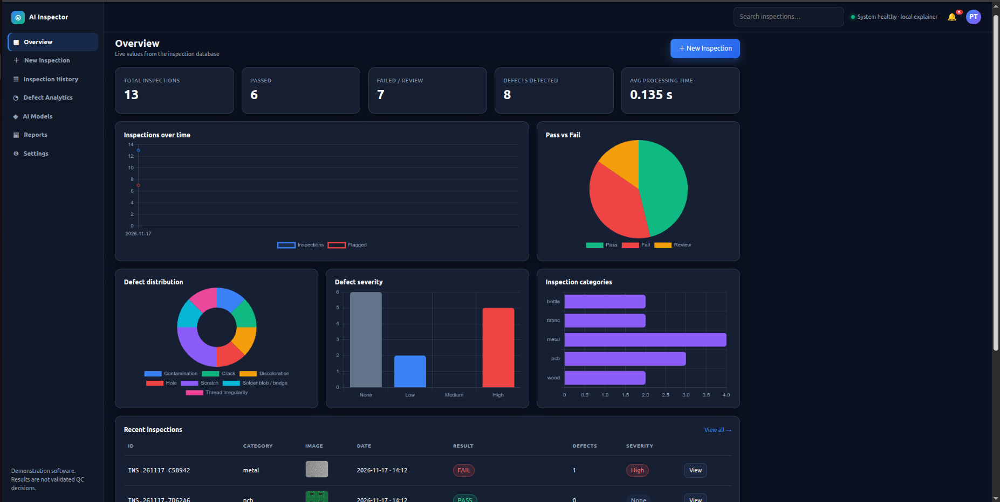
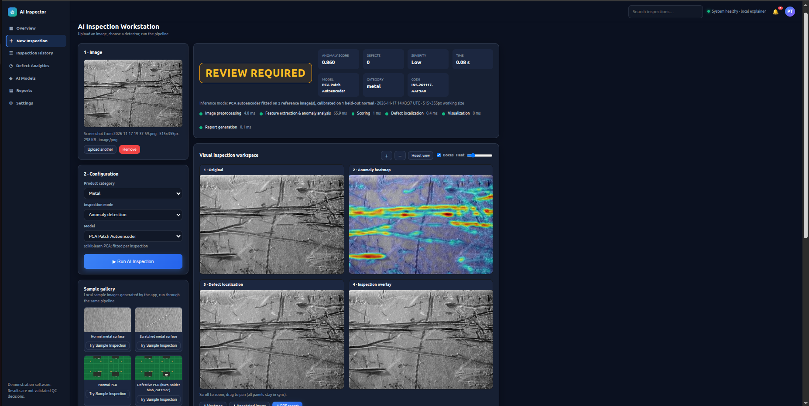
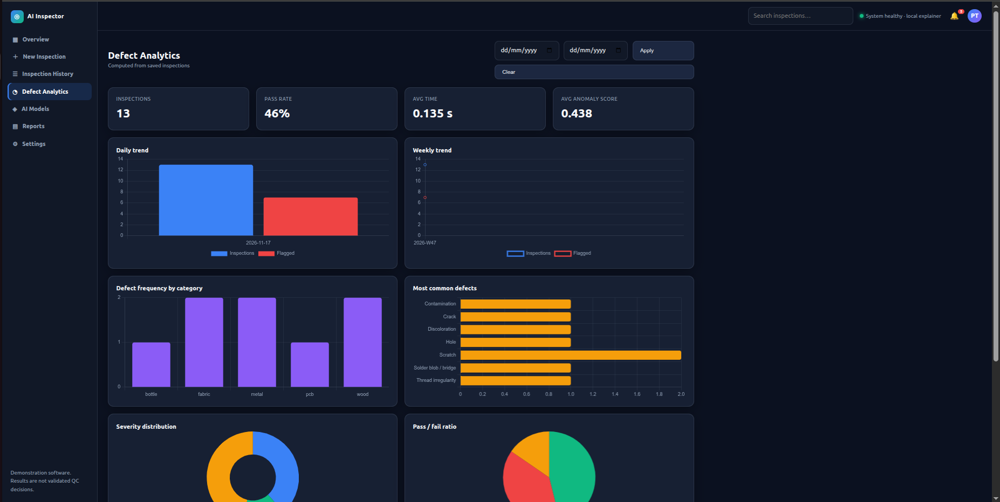
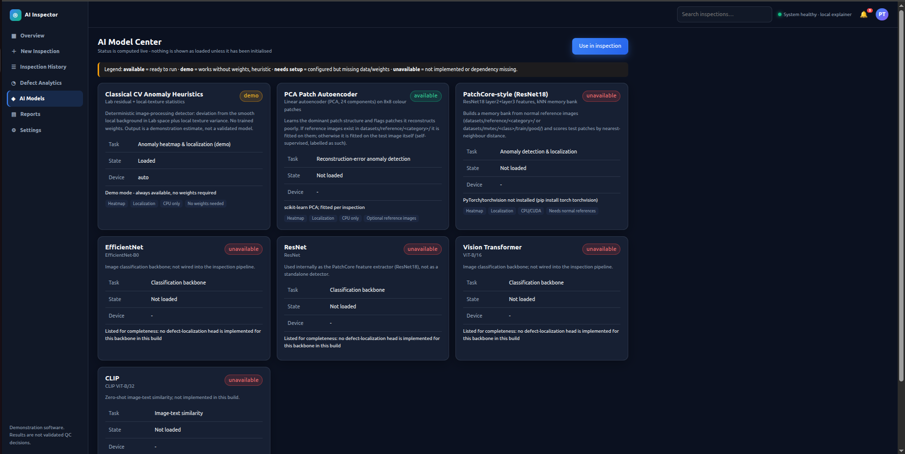
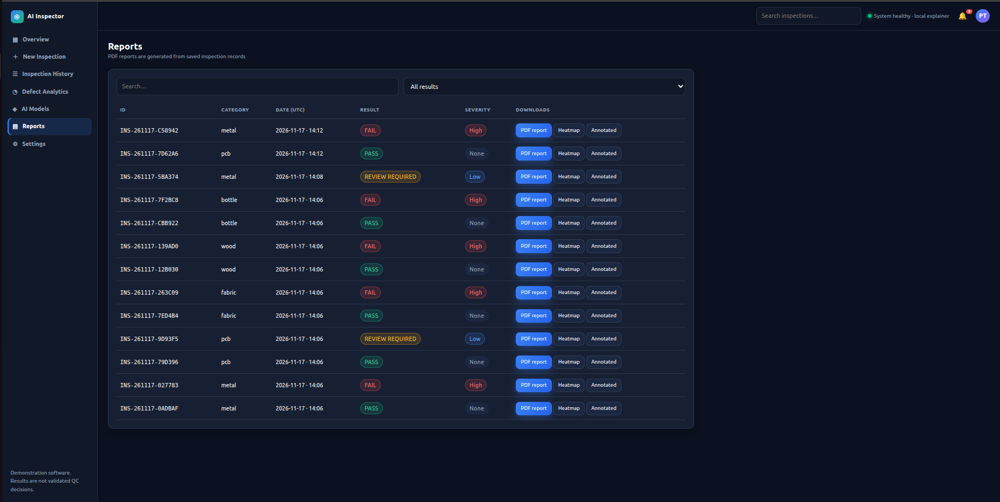
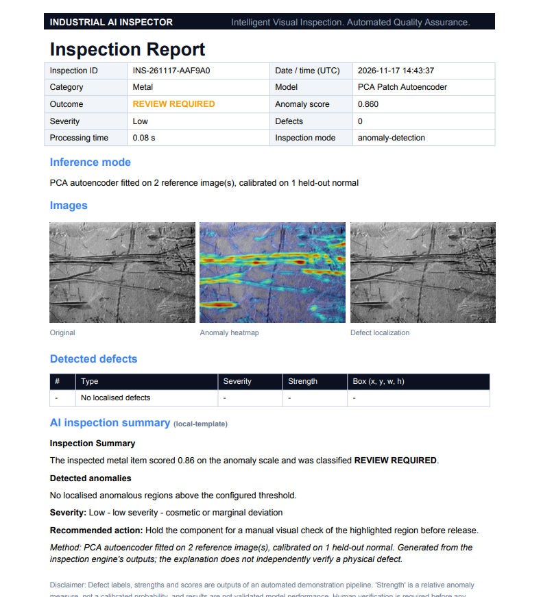
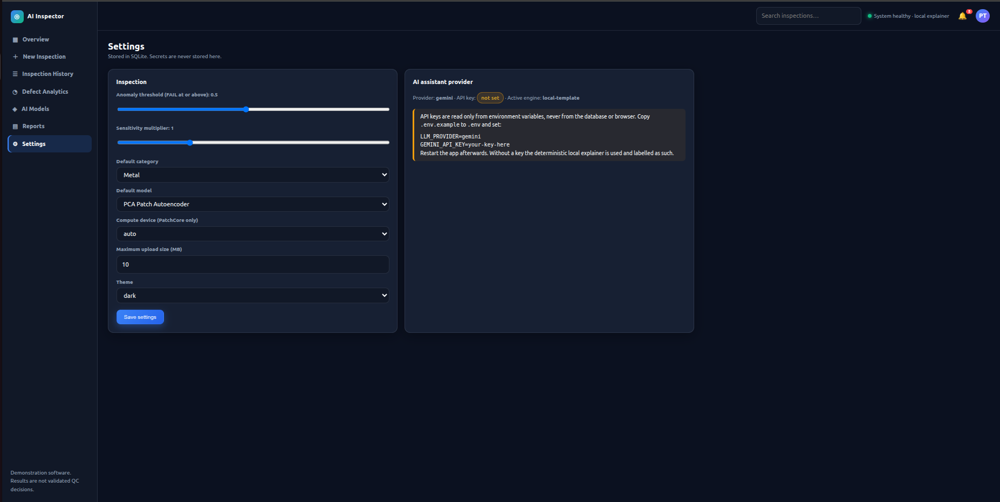

# Industrial AI Inspector
*Intelligent Visual Inspection. Automated Quality Assurance.*

An AI-powered visual inspection demo built with Flask, OpenCV and scikit-learn. Upload a product image and get a PASS / FAIL / REVIEW verdict, an anomaly heatmap, localized defects, an AI explanation, history, analytics and a PDF report. Runs fully offline on CPU.

> Demonstration software. Results are not validated quality-control decisions.

---

## Landing Page
The entry point of the platform: hero section, feature cards, a four-step "how it works" flow and live statistics from the database.



## Dashboard
The main control center: total, passed, failed and defect counts, average processing time, five live charts and a recent-inspections table.



## New Inspection
The AI inspection workstation. Upload or drop an image (or try a bundled sample), pick the category, mode and model, and run the pipeline. Results show the verdict, anomaly score, a 4-panel workspace (original, heatmap, localization, overlay) with zoom and pan, AI explanation and an assistant chat.



## Defect Analysis
Analytics computed from saved inspections: daily and weekly trends, defect frequency by category, most common defects, severity split, pass/fail ratio and model usage, with date-range filters.



## AI Models
The model center. Status is computed live: available, demo-only, needs setup or unavailable. Nothing is shown as loaded unless it has actually been initialised.



## Reports
Generate a professional PDF from any saved inspection, and download the heatmap or annotated image.





## Settings
Anomaly threshold, sensitivity, default category and model, compute device, upload limit and theme. API keys are read only from environment variables.



---


## Quick start (Ubuntu)
```bash
sudo apt install -y python3 python3-venv python3-pip
python3 -m venv venv
source venv/bin/activate
pip install -r requirements.txt
python run.py --init-db      # DB + sample images + 10 sample inspections
python run.py                # http://127.0.0.1:5000
python -m pytest -q tests    # 6 tests
```
Windows: activate with `venv\Scripts\activate`. If port 5000 is busy: `python run.py --port 5001`.

## Detectors
| Detector | Status |
|---|---|
| PCA Patch Autoencoder (default) | Real, CPU. Fitted on normal reference images in `datasets/reference/<category>/`, otherwise on the test image itself (labelled DEMO). |
| Classical CV heuristics | Demo-only, deterministic, no weights. |
| PatchCore-style (ResNet18) | Implemented; needs `pip install torch torchvision` and reference images. Not run in the build sandbox. |
| EfficientNet / ResNet / ViT / CLIP | Listed as unavailable; no localization head wired. |

Defect names are heuristic labels, "strength" is a relative measure (not a probability), and no accuracy figures are claimed. Bundled samples are procedurally generated.

## Configuration
Copy `.env.example` to `.env`. `GEMINI_API_KEY` is optional; without it a local template explainer is used and labelled as such.

## Optional datasets
Nothing is downloaded automatically. Add normal images to `datasets/reference/<metal|fabric|pcb|wood|bottle|general>/`, or extract [MVTec AD](https://www.mvtec.com/company/research/datasets/mvtec-ad) to `datasets/mvtec/` (e.g. `datasets/mvtec/metal_nut/train/good/`).

## Project layout
`app.py` · `routes.py` · `database.py` · `models/` (detectors) · `services/` (processing, explainer, PDF, samples) · `templates/` · `static/` · `tests/`

## API
`POST /api/inspect` · `GET /api/inspections` · `GET|DELETE /api/inspections/<id>` · `GET /api/analytics` · `GET /api/models` · `POST /api/assistant` · `GET /api/reports/<id>` · `GET|POST /api/settings` · `GET /api/health`

## Credits
Built with Flask, OpenCV, scikit-learn, ReportLab and Chart.js (MIT).

---

